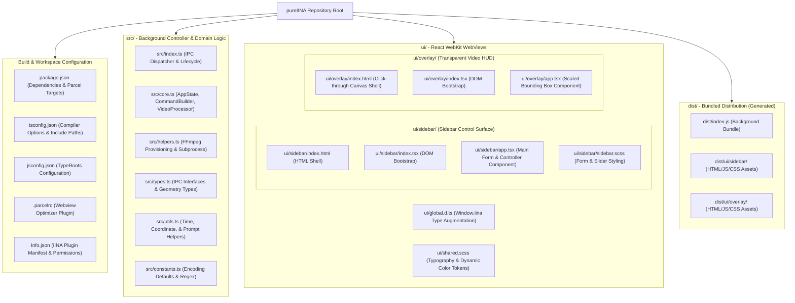
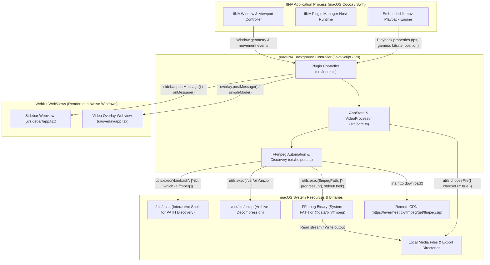
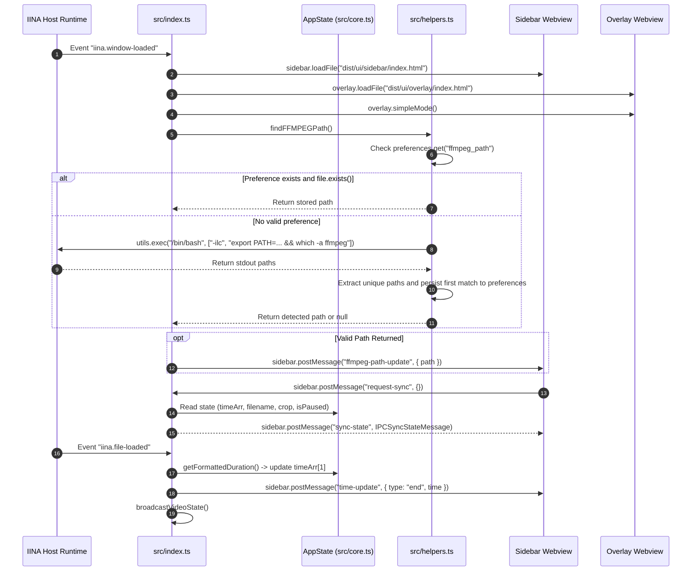
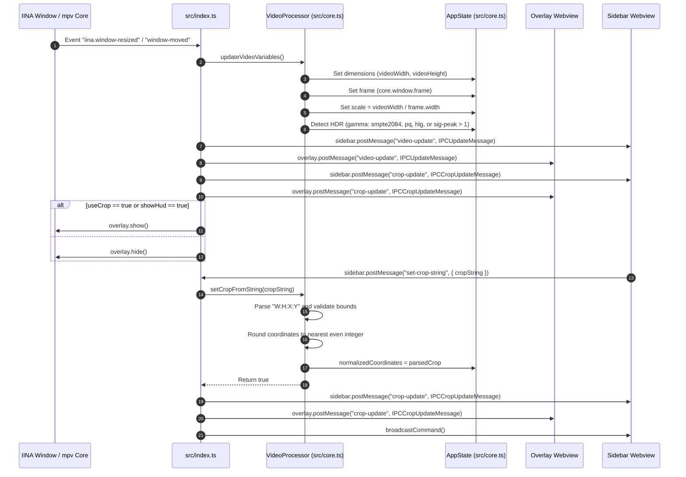
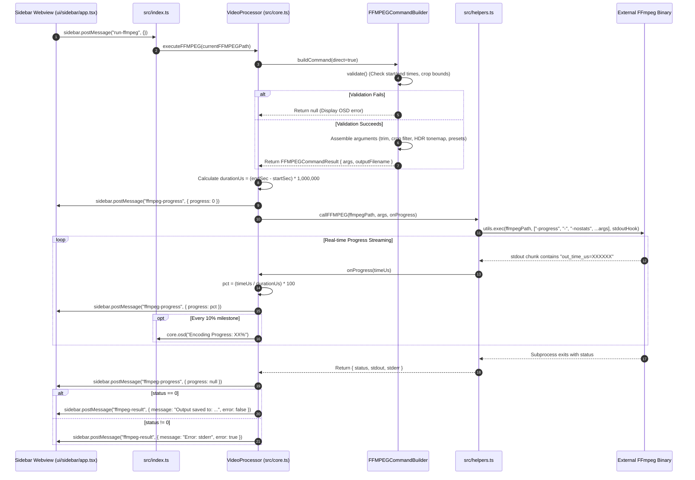
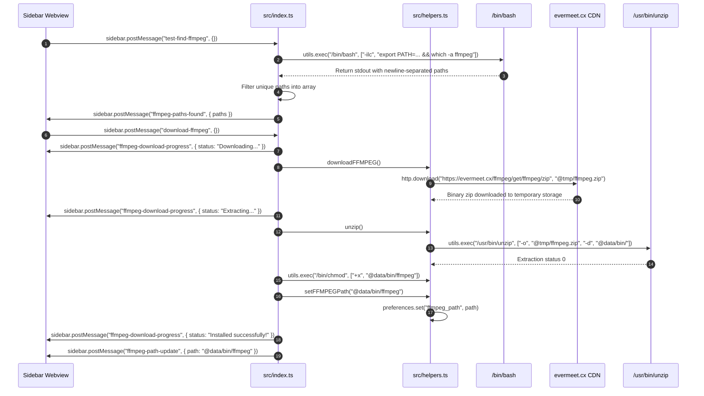
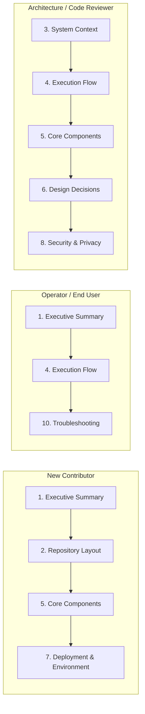

# Architecture Manual: pureIINA

## 1. Executive Summary

`pureIINA` (internally identified as `com.samliburd.pureiina`) is an extensible video processing and workflow automation plugin designed specifically for the macOS open-source media player [IINA](https://iina.io) (inspired by the `purempv` script). Built atop IINA's hybrid JavaScript plugin architecture and `mpv` multimedia backend, `pureIINA` bridges playback-time video inspection with automated FFmpeg-powered media transformation.

The system's core design philosophy emphasizes **non-destructive, zero-latency visual authoring coupled with headless, high-fidelity media manipulation**. Rather than requiring external video editing applications or manual shell script authoring, `pureIINA` exposes an interactive graphical control surface directly within the IINA window chrome. Users can mark precision millisecond-accurate edit boundaries, interactively adjust spatial video crop rectangles overlaid onto active video frames, tonemap high dynamic range (HDR) source streams, and execute transcodes either directly via child process orchestration or through generated shell commands.

### Core Technologies & Tooling

| Technology          | Version / Scope                           | Architectural Role                                                                                                                |
| :------------------ | :---------------------------------------- | :-------------------------------------------------------------------------------------------------------------------------------- |
| **IINA Plugin API** | `v0.0.7` (`iina-plugin-definition`)       | Native host environment providing window management, mpv state bindings, lifecycle events, and inter-process communication.       |
| **WebKit WebViews** | macOS Native WebKit (`safari >= 9`)       | Isolated browser contexts hosting the sidebar graphical user interface and fullscreen transparent video HUD canvas.               |
| **React**           | `^18.2.0`                                 | Declarative user interface runtime powering sidebar state forms, sliders, progress bars, and reactive overlay rendering.          |
| **TypeScript**      | `^7.0.2` (Target: `ES2022`)               | Strict compile-time type safety across domain state, IPC wire protocols, mpv property queries, and external process contracts.    |
| **Parcel**          | `^2.8.3`                                  | Bundler pipeline compiling TypeScript and SCSS into self-contained HTML/JS/CSS assets with WebKit webview optimization.           |
| **Sass / SCSS**     | `@parcel/transformer-sass ^2.8.3`         | Modular design token system providing macOS-native visual styling and dynamic dark-mode palette switching.                        |
| **FFmpeg**          | External Binary (`evermeet.cx` or System) | Underlying multimedia encoding engine executing stream trimming, spatial cropping, HDR-to-SDR tonemapping, and container muxing.  |
| **mpv**             | IINA Core Engine                          | Hardware-accelerated demuxer and playback engine queried for video properties, timestamps, colorimetry, and container parameters. |

### Module / Entry-Point / Subsystem Matrix

| Subsystem / Entry Point            | Source File(s)                                                                                                                                                                                                   | Primary Responsibility                                                                                                                       | Underlying Engine                          |
| :--------------------------------- | :--------------------------------------------------------------------------------------------------------------------------------------------------------------------------------------------------------------- | :------------------------------------------------------------------------------------------------------------------------------------------- | :----------------------------------------- |
| **Plugin Lifecycle Controller**    | [`src/index.ts`](./src/index.ts)                                                                                                                                                                                 | Window lifecycle binding, mpv property polling, IPC message routing, and dual-webview synchronization.                                       | IINA Plugin Host Runtime                   |
| **Domain State & Command Builder** | [`src/core.ts`](./src/core.ts)                                                                                                                                                                                   | Centralized state model (`AppState`), filtergraph synthesis (`FFMPEGCommandBuilder`), and execution controller (`VideoProcessor`).           | TypeScript Domain Logic                    |
| **System & Binary Provisioning**   | [`src/helpers.ts`](./src/helpers.ts)                                                                                                                                                                             | Dynamic PATH resolution, remote binary download/unzip, preference persistence, and streamed stdout progress tracking.                        | `/bin/bash`, `/usr/bin/unzip`, `iina.http` |
| **Domain Types & Wire Protocols**  | [`src/types.ts`](./src/types.ts)                                                                                                                                                                                 | Static interfaces defining IPC message payloads, coordinate models, video track schemas, and command return structures.                      | TypeScript Type System                     |
| **Formatting & Prompt Utilities**  | [`src/utils.ts`](./src/utils.ts)                                                                                                                                                                                 | High-precision ISO-8601 time translation, crop coordinate string parsing, and native macOS directory picker dialogs.                         | `iina.utils.chooseFile`, Date API          |
| **Static Constants & Defaults**    | [`src/constants.ts`](./src/constants.ts)                                                                                                                                                                         | Default encoding presets (CRF 17, libx264, AAC), regex patterns, and baseline time strings.                                                  | Immutable Constants                        |
| **Sidebar Control Webview**        | [`ui/sidebar/app.tsx`](./ui/sidebar/app.tsx)<br>[`ui/sidebar/index.tsx`](./ui/sidebar/index.tsx)<br>[`ui/sidebar/index.html`](./ui/sidebar/index.html)<br>[`ui/sidebar/sidebar.scss`](./ui/sidebar/sidebar.scss) | Interactive control surface providing trimming controls, crop coordinate sliders, FFmpeg settings, command preview, and progress monitoring. | React 18, WebKit WebView                   |
| **Overlay HUD Webview**            | [`ui/overlay/app.tsx`](./ui/overlay/app.tsx)<br>[`ui/overlay/index.tsx`](./ui/overlay/index.tsx)<br>[`ui/overlay/index.html`](./ui/overlay/index.html)                                                           | Transparent, click-through video canvas rendering a live bounding box scaled to normalized video coordinates.                                | React 18, WebKit Overlay                   |
| **Plugin Manifest**                | [`Info.json`](./Info.json)                                                                                                                                                                                       | Metadata registration, permission declarations (`video-overlay`, `file-system`), entry point definitions, and sidebar tab naming.            | IINA Plugin Loader                         |

---

## 2. Repository Layout

The repository is organized into distinct domain layers separating the plugin runtime controller, core encoding logic, shared types, and decoupled React webviews.



### Configuration & Workspace Files Table

| File                               | Purpose                                                                                           | Key Settings & Structural Invariants                                                                                                                                                                                                                          |
| :--------------------------------- | :------------------------------------------------------------------------------------------------ | :------------------------------------------------------------------------------------------------------------------------------------------------------------------------------------------------------------------------------------------------------------ |
| [`Info.json`](./Info.json)         | IINA Plugin Manifest declaring identification, permissions, and entry points.                     | Defines `identifier: "com.samliburd.pureiina"`, `entry: "dist/index.js"`, `sidebarTab.name: "pureIINA"`, and permissions (`show-osd`, `show-alert`, `video-overlay`, `network-request`, `file-system`).                                                        |
| [`package.json`](./package.json)   | NPM package definition, dependency lock, script lifecycle, and multi-target Parcel configuration. | Defines scripts `serve-sidebar`, `serve-overlay`, and `build`. Configures three compilation targets: `overlay` (`outputFormat: "global"`), `sidebar` (`outputFormat: "global"`), and `entry` (`distDir: "./dist/"`). Specifies `browserslist: "safari >= 9"`. |
| [`tsconfig.json`](./tsconfig.json) | TypeScript compiler options and compilation scope.                                                | Specifies `target: "ES2022"`, `module: "ESNext"`, `jsx: "react"`, `moduleResolution: "node"`, `strict: true`. Includes `src/**/*`, `ui/**/*`, and `node_modules/iina-plugin-definition/iina/**/*.d.ts`.                                                       |
| [`jsconfig.json`](./jsconfig.json) | IDE path resolution and secondary type root lookup.                                               | Binds `typeRoots` to `./node_modules/@types` and `./node_modules/iina-plugin-definition`.                                                                                                                                                                     |
| [.parcelrc](./.parcelrc)           | Parcel bundler configuration extension.                                                           | Extends `@parcel/config-default` and registers `parcel-optimizer-webview` for all `*.html` bundles to inline scripts and styles for WebKit compatibility.                                                                                                     |
| [`.gitignore`](./.gitignore)       | Version control exclusion rules.                                                                  | Excludes build caches (`.parcel-cache`), distribution directories (`dist/`), local crash dumps, and development configurations.                                                                                                                               |

### Package & Namespace Wiring

The compilation and execution pipelines diverge across the background process and the UI surfaces:

1. **Background Runtime Target (`entry`)**: [`src/index.ts`](./src/index.ts) is compiled by Parcel into a single JavaScript file at `dist/index.js`. It does not execute in a standard browser DOM or Node.js environment; instead, it runs within IINA's JavaScript runtime, where the global `iina` object is injected into the global execution context.
2. **UI Webview Targets (`sidebar` & `overlay`)**: [`ui/sidebar/index.html`](./ui/sidebar/index.html) and [`ui/overlay/index.html`](./ui/overlay/index.html) serve as independent entry points. Parcel compiles their respective React TypeScript trees ([`ui/sidebar/index.tsx`](./ui/sidebar/index.tsx) and [`ui/overlay/index.tsx`](./ui/overlay/index.tsx)) using `outputFormat: "global"`. The `parcel-optimizer-webview` plugin transforms linked scripts and stylesheets into inline bundles within the generated HTML pages in `dist/ui/sidebar/` and `dist/ui/overlay/`, satisfying WebKit local file restriction boundaries.

---

## 3. System Context

`pureIINA` sits at the junction between IINA's Cocoa/Swift host layer, the embedded `mpv` C core, isolated WebKit browser instances, and macOS operating system utilities.



### Cross-Submodule / Cross-Layer Contract Matrix

| Integration Boundary                                    | Communication Protocol                                                                           | Data Contract / Payload Schema                                                                                                                                   | Failure & Exception Handling                                                                                                    |
| :------------------------------------------------------ | :----------------------------------------------------------------------------------------------- | :--------------------------------------------------------------------------------------------------------------------------------------------------------------- | :------------------------------------------------------------------------------------------------------------------------------ |
| **Plugin Controller $\leftrightarrow$ Sidebar Webview** | Bi-directional IINA Webview IPC (`sidebar.postMessage` / `sidebar.onMessage`)                    | Typed messages: `IPCTimeUpdateMessage`, `IPCSyncStateMessage`, `IPCCropUpdateMessage`, `IPCUpdateMessage`, `IPCFFMPEGProgressMessage`, `IPCFFMPEGResultMessage`. | Message drops if webview is unmounted; initial state synchronized via explicit `request-sync` request upon webview mount.       |
| **Plugin Controller $\leftrightarrow$ Overlay Webview** | Uni-directional IINA Webview IPC (`overlay.postMessage`)                                         | `IPCUpdateMessage` (viewport geometry, video resolution, scale factor), `IPCCropUpdateMessage` (normalized crop box).                                            | Canvas hidden (`overlay.hide()`) when `useCrop` and `showHud` are false; click-through enforced via CSS `pointer-events: none`. |
| **Plugin Controller $\leftrightarrow$ Embedded mpv**    | Synchronous JavaScript Bridge (`iina.mpv.getNative`, `iina.mpv.getString`, `iina.mpv.getNumber`) | Native dictionary lookups (`video-params`, `gamma`, `colormatrix`, `sig-peak`, `container-fps`, `video-bitrate`).                                                | Wrapped in `try/catch` blocks; defaults to safe SDR fallback values on missing or uninitialized playback tracks.                |
| **Helper Engine $\leftrightarrow$ Shell Subprocess**    | Asynchronous Process Execution (`iina.utils.exec`)                                               | Positional arguments vector, optional `stdin`, and streaming `stdout` chunk hooks.                                                                               | Status code evaluation; non-zero exit statuses return structured error results to UI with captured `stderr`.                    |
| **Helper Engine $\leftrightarrow$ Remote Evermeet API** | Native HTTP Download (`iina.http.download`)                                                      | HTTP GET transfer to `@tmp/ffmpeg.zip`.                                                                                                                          | Network error caught and reported back to UI state as failure string.                                                           |
| **Command Builder $\leftrightarrow$ Local File System** | URI Decoded String Manipulation & Native File Dialogs                                            | `file://` URI prefix stripping, URI decoding, and native Cocoa directory selection (`utils.chooseFile`).                                                         | Returns `null` if file is remote stream or if user dismisses NSOpenPanel without selecting a directory.                         |

---

## 4. Execution Flow

### 4.1 Plugin Lifecycle & Initialization Flow

When a video window is created in IINA, the plugin bootstraps its isolated webviews, discovers or validates the local FFmpeg binary, and subscribes to window and playback event streams.



#### Step-by-Step Walkthrough

1. **Window Registration**: The IINA runtime dispatches the `iina.window-loaded` event when an application window finishes initialization.
2. **Webview Loading**: [`src/index.ts`](./src/index.ts) instructs the host to load `dist/ui/sidebar/index.html` into the sidebar drawer and `dist/ui/overlay/index.html` into the video viewport overlay.
3. **Overlay Configuration**: The overlay is switched into `simpleMode()` via `overlay.simpleMode()`, binding its geometry directly to the player viewport and optimizing rendering performance.
4. **FFmpeg Path Resolution**: `findFFMPEGPath()` queries `iina.preferences` for `ffmpeg_path`. If missing or invalid on disk, it executes an interactive login Bash shell invoking `which -a ffmpeg` against an expanded search `$PATH` including `/opt/homebrew/bin`, `/usr/local/bin`, and the plugin data directory `@data/bin`.
5. **Preference Synchronization**: If a binary is detected, it is persisted to plugin preferences and communicated to the sidebar via `ffmpeg-path-update`.
6. **State Rehydration**: The sidebar mounts and posts `request-sync`. The background controller responds with `sync-state` containing the full initial snapshot.
7. **File Association**: When a media file is opened, `iina.file-loaded` triggers baseline duration calculation via `core.status.duration`, establishing the default cut end time and firing `broadcastVideoState()`.

---

### 4.2 Spatial Geometry & Video Crop Synchronization Flow

To support interactive video cropping, changes in video dimensions, window bounds, or crop sliders must be calculated, scaled, and synchronized across both webviews.



#### Step-by-Step Walkthrough

1. **Geometry Invalidation**: Window adjustments (`iina.window-resized`, `iina.window-moved`, `iina.window-size-adjusted`) invoke `broadcastVideoState()`.
2. **Dimension & Scale Calculation**: `VideoProcessor.updateVideoVariables()` reads `core.status.videoWidth`, `videoHeight`, and `core.window.frame`. The scaling ratio is calculated as $\text{scale} = \frac{\text{videoWidth}}{\text{frame.width}}$.
3. **HDR Signal Detection**: The processor inspects `video-params/gamma` and `sig-peak`. If the transfer function matches SMPTE 2084 (PQ) or ARIB STD-B67 (HLG), or if peak signal brightness exceeds 1.0, `state.isHDR` is toggled true.
4. **Dual Dispatch**: The controller broadcasts `video-update` (geometry, track metadata, pause state) and `crop-update` (normalized crop box) to both sidebar and overlay.
5. **Visibility Toggling**: If cropping or the HUD is active, `overlay.show()` makes the overlay canvas visible; otherwise, `overlay.hide()` suppresses rendering overhead.
6. **User Crop Mutation**: When the user edits the crop text field or moves the X/Y offset sliders in the sidebar, the sidebar dispatches `set-crop-string`.
7. **Coordinate Validation & Chroma Even-Rounding**: `VideoProcessor.setCropFromString()` parses `width:height:x:y`. It validates that boundaries fall strictly within video dimensions and rounds all four integers to the nearest even number using `Math.round(val / 2) * 2`, preventing YUV420p chroma subsampling misalignment.
8. **Live HUD Re-rendering**: The normalized crop coordinates are persisted to `state.normalizedCoordinates`, dispatched to the overlay, and re-rendered on the video canvas.

---

### 4.3 FFmpeg Encoding & Real-Time Progress Pipeline

When the user triggers video export, `pureIINA` executes FFmpeg directly as an asynchronous subprocess and streams progress indicators back to the user interface.



#### Step-by-Step Walkthrough

1. **Trigger & Path Verification**: The user clicks "Run FFmpeg". The sidebar posts `run-ffmpeg`. The controller verifies that `currentFFMPEGPath` is valid.
2. **Command Synthesis**: `FFMPEGCommandBuilder._buildDirectCommand()` constructs the arguments array. It applies seek boundaries (`-ss`, `-to`), input source (`-i`), video filters (`crop=W:H:X:Y` and optional HDR `zscale`/`tonemap` pipeline), encoding parameters matching the selected codec (e.g., `-c:v libx264 -crf 17 -preset fast`, `-c:v libx265 -crf 22 -preset fast -tag:v hvc1`, or hardware-accelerated `-c:v h264_videotoolbox -q:v 75` / `-c:v hevc_videotoolbox -q:v 75 -tag:v hvc1`), audio parameters (`-c:a aac -ac 2`), metadata stripping (`-map_metadata -1`), and MP4 container optimization (`-movflags +faststart`).
3. **Output Path Resolution**: If the user has not configured a custom output directory via `set-output-dir`, the builder extracts the input video's parent directory using URI decoding on `core.status.url`.
4. **Time Calculation**: The processor converts ISO start and end timestamps into seconds, calculating total microsecond duration ($\text{durationUs} = (\text{endSec} - \text{startSec}) \times 1{,}000{,}000$).
5. **Process Spawning with Progress Flags**: `callFFMPEG()` appends `-progress -` and `-nostats` to the options vector and invokes `iina.utils.exec` with a streaming `stdoutHook`.
6. **Progress Parsing**: As FFmpeg outputs progress data to `stdout`, the regex `/out_time_us=(\d+)/` extracts elapsed microseconds. Percentage completion is computed and dispatched to the sidebar's progress bar.
7. **Termination & Notification**: Upon exit code evaluation, `ffmpeg-progress` is cleared, and an `ffmpeg-result` payload updates the sidebar with either a success confirmation or error details.

---

### 4.4 Automated FFmpeg Discovery & Download Pipeline

For users without FFmpeg installed, `pureIINA` provides automated discovery and automated network downloading.



#### Step-by-Step Walkthrough

1. **System Discovery**: The user clicks "Find ffmpeg" in the settings drawer. The controller runs `which -a ffmpeg` within a login shell, ensuring that user configuration profiles (`.bashrc`, `.zshrc`) and Homebrew paths are resolved.
2. **Download Initiation**: If no local binary exists, the user selects "Download ffmpeg".
3. **HTTP Fetch**: `iina.http.download` streams the official static macOS build zip from `evermeet.cx` to the sandboxed path `@tmp/ffmpeg.zip`.
4. **Extraction**: The system `/usr/bin/unzip` utility decompresses the archive into `@data/bin/`, an isolated persistent storage directory allocated to the plugin.
5. **Permission Hardening**: The controller executes `/bin/chmod +x` against the extracted binary to ensure executable permissions.
6. **Activation**: The path is stored in preferences and dispatched to the sidebar.

---

## 5. Core Components

### 5.1 Plugin Lifecycle Controller (`src/index.ts`)

- **Source File**: [`src/index.ts`](./src/index.ts)
- **Architectural Role**: Central event coordinator and IPC message router connecting IINA's application lifecycle and mpv core to the UI webviews.

#### Symbol & Function Inventory

| Symbol                | Signature                               | Return Type              | Description                                                                                                                                              |
| :-------------------- | :-------------------------------------- | :----------------------- | :------------------------------------------------------------------------------------------------------------------------------------------------------- |
| `appState`            | `const appState: AppState`              | `AppState`               | Singleton domain state container holding playback boundaries, crop geometry, and configuration.                                                          |
| `videoProcessor`      | `const videoProcessor: VideoProcessor`  | `VideoProcessor`         | Singleton processor orchestrating coordinate transformations and subprocess executions.                                                                  |
| `currentFFMPEGPath`   | `let currentFFMPEGPath: string \| null` | `string \| null`         | Cached filesystem path to the active FFmpeg binary.                                                                                                      |
| `getVideoTrackInfo`   | `() => VideoTrackInfo \| null`          | `VideoTrackInfo \| null` | Queries `core.video.currentTrack` and `mpv.getNative("video-params")` to construct video stream specifications, colorimetry, frame rates, and HDR types. |
| `broadcastVideoState` | `() => void`                            | `void`                   | Updates video geometry in `videoProcessor`, builds `IPCUpdateMessage`, posts to sidebar/overlay, and triggers `sendCropState()`.                         |
| `sendCropState`       | `() => void`                            | `void`                   | Constructs `IPCCropUpdateMessage` with normalized coordinates, posts to both webviews, and toggles overlay visibility (`show()` / `hide()`).             |
| `broadcastCommand`    | `() => void`                            | `void`                   | Synthesizes a shell-escaped FFmpeg CLI command from current state and dispatches `command-result` to the sidebar.                                        |

#### IPC Event Mapping Table

| Event Channel      | Direction                              | Payload Interface          | Internal Trigger & Handling Behavior                                                                |
| :----------------- | :------------------------------------- | :------------------------- | :-------------------------------------------------------------------------------------------------- |
| `toggle-pause`     | Inbound (Sidebar $\rightarrow$ Host)   | `{}`                       | Checks `core.status.paused`; toggles playback via `core.resume()` or `core.pause()`.                |
| `set-start-time`   | Inbound (Sidebar $\rightarrow$ Host)   | `{}`                       | Invokes `videoProcessor.setTimePosition(0)`; emits OSD confirmation and broadcasts updated command. |
| `set-end-time`     | Inbound (Sidebar $\rightarrow$ Host)   | `{}`                       | Invokes `videoProcessor.setTimePosition(1)`; emits OSD confirmation and broadcasts updated command. |
| `request-sync`     | Inbound (Sidebar $\rightarrow$ Host)   | `{}`                       | Emits full snapshot payload (`IPCSyncStateMessage`) to synchronize UI on mount.                     |
| `set-filename`     | Inbound (Sidebar $\rightarrow$ Host)   | `IPCSetFilenameMessage`    | Mutates `appState.outputFilename` and refreshes clipboard command string.                           |
| `set-ffmpeg-path`  | Inbound (Sidebar $\rightarrow$ Host)   | `IPCSetFFMPEGPathMessage`  | Validates path via `setFFMPEGPath(path)`; updates `currentFFMPEGPath` and persists to preferences.  |
| `set-output-dir`   | Inbound (Sidebar $\rightarrow$ Host)   | `{}`                       | Invokes native Cocoa folder selection dialog; updates `appState.outputDir`.                         |
| `toggle-crop`      | Inbound (Sidebar $\rightarrow$ Host)   | `{}`                       | Flips boolean `appState.useCrop`, updates overlay visibility, and dispatches state updates.         |
| `set-crop-string`  | Inbound (Sidebar $\rightarrow$ Host)   | `IPCSetCropStringMessage`  | Validates and applies `W:H:X:Y` crop string; re-broadcasts crop coordinates to overlay.             |
| `get-command`      | Inbound (Sidebar $\rightarrow$ Host)   | `{}`                       | Explicitly invokes `broadcastCommand()`.                                                            |
| `run-ffmpeg`       | Inbound (Sidebar $\rightarrow$ Host)   | `{}`                       | Triggers `videoProcessor.executeFFMPEG(currentFFMPEGPath)` with progress streaming.                 |
| `test-find-ffmpeg` | Inbound (Sidebar $\rightarrow$ Host)   | `{}`                       | Executes interactive Bash shell to query `which -a ffmpeg`; posts results to `ffmpeg-paths-found`.  |
| `download-ffmpeg`  | Inbound (Sidebar $\rightarrow$ Host)   | `{}`                       | Downloads, extracts, and provisions static binary from `evermeet.cx`.                               |
| `video-update`     | Outbound (Host $\rightarrow$ Webviews) | `IPCUpdateMessage`         | Geometry, dimensions, scale factor, video track metadata, and pause state.                          |
| `crop-update`      | Outbound (Host $\rightarrow$ Webviews) | `IPCCropUpdateMessage`     | Active bounding box coordinates in normalized video pixel space.                                    |
| `time-update`      | Outbound (Host $\rightarrow$ Sidebar)  | `IPCTimeUpdateMessage`     | Notification of start or end cut boundary updates.                                                  |
| `sync-state`       | Outbound (Host $\rightarrow$ Sidebar)  | `IPCSyncStateMessage`      | Complete state snapshot sent in response to `request-sync`.                                         |
| `command-result`   | Outbound (Host $\rightarrow$ Sidebar)  | `IPCCommandResultMessage`  | Formatted shell-escaped FFmpeg CLI command string.                                                  |
| `ffmpeg-progress`  | Outbound (Host $\rightarrow$ Sidebar)  | `IPCFFMPEGProgressMessage` | Real-time percentage completion or `null` when idle.                                                |
| `ffmpeg-result`    | Outbound (Host $\rightarrow$ Sidebar)  | `IPCFFMPEGResultMessage`   | Terminal completion status string and error indicator.                                              |

---

### 5.2 Core Domain State & Execution Engine (`src/core.ts`)

- **Source File**: [`src/core.ts`](./src/core.ts)
- **Architectural Role**: Defines the persistent state model (`AppState`), dynamic filtergraph construction (`FFMPEGCommandBuilder`), and subprocess coordination (`VideoProcessor`).

#### Class & Data Model Inventory

| Class                  | Properties & Constants                                                                                                                                                                                                                                                                                                                                                                     | Method Signatures                                                                                                                                                                                                               | Description                                                                                                                           |
| :--------------------- | :----------------------------------------------------------------------------------------------------------------------------------------------------------------------------------------------------------------------------------------------------------------------------------------------------------------------------------------------------------------------------------------- | :------------------------------------------------------------------------------------------------------------------------------------------------------------------------------------------------------------------------------ | :------------------------------------------------------------------------------------------------------------------------------------ |
| `AppState`             | `dimensions: Dimensions \| null`<br>`frame: Rect \| null`<br>`scale: number \| null`<br>`rectangleCoordinates: Rect \| null`<br>`normalizedCoordinates: Rect \| null`<br>`isHidden: boolean`<br>`timeArr: string[]`<br>`outputDir: string \| null`<br>`outputFilename: string`<br>`useCrop: boolean`<br>`showHud: boolean`<br>`startTime: string`<br>`endTime: string`<br>`isHDR: boolean` | `getFormattedDuration(): string`<br>`getCurrentFilename(): string`<br>`getInputFileDirectory(): string \| null`<br>`reset(): void`                                                                                              | Central domain model maintaining video dimensions, display frame bounds, scaling ratios, timestamp boundaries, and target file paths. |
| `FFMPEGCommandBuilder` | `state: AppState`                                                                                                                                                                                                                                                                                                                                                                          | `validate(): string[]`<br>`buildCommand(direct?: boolean): FFMPEGCommandResult \| string \| null`<br>`_buildDirectCommand(filename: string): FFMPEGCommandResult \| null`<br>`_buildClipboardCommand(filename: string): string` | Assembles validated arguments vectors for direct process execution or escaped shell command strings for clipboard sharing.            |
| `VideoProcessor`       | `state: AppState`<br>`commandBuilder: FFMPEGCommandBuilder`                                                                                                                                                                                                                                                                                                                                | `updateVideoVariables(): void`<br>`setTimePosition(index: number): string`<br>`toggleCrop(): void`<br>`setCropFromString(cropStr: string): boolean`<br>`executeFFMPEG(ffmpegPath: string): Promise<void>`                       | Manages player timeline queries, crop string parsing and bounds checking, and asynchronous FFmpeg process execution.                  |

#### Internal Mechanics & Edge Cases

1. **HDR Tone-Mapping Filtergraph Injection**:
   When `state.isHDR` is true, both `_buildDirectCommand` and `_buildClipboardCommand` automatically inject an advanced `zscale` and `tonemap` filtergraph:

   ```text
   zscale=t=linear:npl=100,format=gbrpf32le,zscale=p=bt709,tonemap=tonemap=hable:desat=0,zscale=t=bt709:m=bt709:r=tv,format=yuv420p
   ```

   This converts wide-gamut high-dynamic-range content (PQ or HLG) to standard BT.709 SDR using the Hable tonemapping algorithm. Explicit output color parameters (`-pix_fmt yuv420p -colorspace bt709 -color_primaries bt709 -color_trc bt709`) prevent washed-out color reproduction in standard players.

2. **Even Coordinate Normalization**:
   Video encoders using YUV420p chroma subsampling require all dimensions and coordinate offsets to be even integers. `VideoProcessor.setCropFromString()` applies:

   ```typescript
   const toEven = (val: number) => Math.round(val / 2) * 2;
   ```

   to width, height, x, and y parameters before persisting them to `normalizedCoordinates`.

3. **Microsecond Progress Computation**:
   FFmpeg's `-progress -` output streams progress in microseconds (`out_time_us`). `VideoProcessor.executeFFMPEG()` converts ISO start and end strings to float seconds using `TimeUtils.isoToSeconds()`, calculates $\text{durationUs} = (\text{endSec} - \text{startSec}) \times 1{,}000{,}000$, and continuously computes:

   ```typescript
   let pct = (timeUs / durationUs) * 100;
   ```

   clamping values to $[0, 100]$ and firing IINA OSD alerts at every $10\%$ milestone.

---

### 5.3 System Helpers & Subprocess Automation (`src/helpers.ts`)

- **Source File**: [`src/helpers.ts`](./src/helpers.ts)
- **Architectural Role**: Low-level integration surface managing external binary execution, PATH discovery, archive decompression, and HTTP downloads.

#### Symbol & Function Inventory

| Symbol            | Signature                                                                                                                                       | Return Type                           | Description                                                                            |
| :---------------- | :---------------------------------------------------------------------------------------------------------------------------------------------- | :------------------------------------ | :------------------------------------------------------------------------------------- |
| `FFMPEG_URL`      | `const FFMPEG_URL: string`                                                                                                                      | `string`                              | Remote static binary download URL: `https://evermeet.cx/ffmpeg/get/ffmpeg/zip`.        |
| `FFMPEG_ZIP_PATH` | `const FFMPEG_ZIP_PATH: string`                                                                                                                 | `string`                              | Resolved temporary download destination (`@tmp/ffmpeg.zip`).                           |
| `BINARY_DIR_PATH` | `const BINARY_DIR_PATH: string`                                                                                                                 | `string`                              | Resolved persistent plugin binary directory (`@data/bin/`).                            |
| `logger`          | `(msg: string) => void`                                                                                                                         | `void`                                | Writes log messages to both IINA console and on-screen display (OSD).                  |
| `downloadFFMPEG`  | `() => Promise<boolean \| string>`                                                                                                              | `Promise<boolean \| string>`          | Asynchronously downloads the static FFmpeg zip archive using `iina.http.download`.     |
| `unzip`           | `() => Promise<number \| undefined>`                                                                                                            | `Promise<number \| undefined>`        | Executes `/usr/bin/unzip -o @tmp/ffmpeg.zip -d @data/bin/` via `iina.utils.exec`.      |
| `findFFMPEGPath`  | `() => Promise<string \| null>`                                                                                                                 | `Promise<string \| null>`             | Queries stored preferences or spawns an interactive login Bash shell to locate FFmpeg. |
| `setFFMPEGPath`   | `(newPath: string) => boolean`                                                                                                                  | `boolean`                             | Verifies binary existence via `iina.file.exists()` and saves to preferences.           |
| `callFFMPEG`      | `(ffmpegPath: string, options: string[], onProgress?: (timeUs: number) => void) => Promise<{ status: number; stdout: string; stderr: string }>` | `Promise<{ status, stdout, stderr }>` | Executes FFmpeg subprocess with `-progress -` and hooks into streaming stdout.         |
| `findBinary`      | `() => string`                                                                                                                                  | `string`                              | Legacy binary resolver checking `@data/ffmpeg` and system PATH.                        |

---

### 5.4 Utility & Geometry Helpers (`src/utils.ts`)

- **Source File**: [`src/utils.ts`](./src/utils.ts)
- **Architectural Role**: Pure mathematical and formatting utilities handling time translation, crop coordinate serialization, and native file dialogs.

#### Symbol & Function Inventory

| Class             | Method                   | Signature                                         | Return Type               | Description                                                                            |
| :---------------- | :----------------------- | :------------------------------------------------ | :------------------------ | :------------------------------------------------------------------------------------- |
| `TimeUtils`       | `secondsToISO`           | `(time: number) => string`                        | `string`                  | Converts floating-point seconds into zero-padded `HH:MM:SS.mmm` ISO timestamps.        |
| `TimeUtils`       | `getCurrentTimePosition` | `() => string`                                    | `string`                  | Samples `core.status.position` and converts it to formatted ISO string.                |
| `TimeUtils`       | `isoToSeconds`           | `(iso: string) => number`                         | `number`                  | Parses `HH:MM:SS.mmm` string into total floating-point seconds.                        |
| `CoordinateUtils` | `parseCropString`        | `(cropString: string) => Rect \| null`            | `Rect \| null`            | Splits `W:H:X:Y` string, parses base-10 integers, and returns `Rect` or `null`.        |
| `CoordinateUtils` | `cropToCoordsString`     | `(normalizedCoordinates: Rect \| null) => string` | `string`                  | Serializes `Rect` object into standard `width:height:x:y` string or `"0:0:0:0"`.       |
| `UserPrompts`     | `promptOutputDir`        | `() => Promise<string \| null>`                   | `Promise<string \| null>` | Prompts user with native Cocoa directory selection dialog via `iina.utils.chooseFile`. |

---

### 5.5 Static Constants & Defaults (`src/constants.ts`)

- **Source File**: [`src/constants.ts`](./src/constants.ts)
- **Architectural Role**: Immutable encoding configurations and regex definitions.

| Constant             | Type                                     | Value                                                                                | Description                                                                            |
| :------------------- | :--------------------------------------- | :----------------------------------------------------------------------------------- | :------------------------------------------------------------------------------------- |
| `REGEX_WHITESPACE`   | `RegExp`                                 | `/\s/g`                                                                              | Matches whitespace characters for shell path escaping.                                 |
| `DEFAULT_START_TIME` | `string`                                 | `"00:00:00.000"`                                                                     | Initial cut start timestamp.                                                           |
| `VIDEO_EXTENSIONS`   | `RegExp`                                 | `/[-\w\s\.]+\.(mp4\|webm\|mkv\|avi\|...)/gim`                                        | Validates standard multimedia file extensions.                                         |
| `DEFAULT_CODEC`      | `VideoCodec`                             | `"x264"`                                                                             | Default selected video encoding codec.                                                 |
| `CODEC_CONFIGS`      | `Record<VideoCodec, CodecOptionConfig>`  | Configuration map (`x264`, `x265`, `h264_videotoolbox`, `hevc_videotoolbox`)         | Defines encoders, quality parameters (`-crf` / `-q:v`), presets, and container tags.   |
| `FFMPEG_DEFAULTS`    | `object`                                 | `{ codec: "libx264", crf: 17, preset: "fast", audioCodec: "aac", container: "mp4" }` | Default production encoding parameters balancing visual quality and compression speed. |

---

### 5.6 Data Models & Wire Protocols (`src/types.ts`)

- **Source File**: [`src/types.ts`](./src/types.ts)
- **Architectural Role**: Type contracts for internal geometry, media track metadata, and inter-process communication.

| Interface                  | Fields                                                                                                                                                           | Description                                                              |
| :------------------------- | :--------------------------------------------------------------------------------------------------------------------------------------------------------------- | :----------------------------------------------------------------------- |
| `Point`                    | `x: number`, `y: number`                                                                                                                                         | 2D cartesian coordinates.                                                |
| `Dimensions`               | `videoWidth: number`, `videoHeight: number`                                                                                                                      | Native pixel dimensions of the video stream.                             |
| `Rect`                     | `x: number`, `y: number`, `width: number`, `height: number`                                                                                                      | 2D bounding rectangle.                                                   |
| `VideoTrackInfo`           | `trackTitle?`, `codec?`, `pixelFormat?`, `colorSpace?`, `primaries?`, `gamma?`, `colorLevels?`, `bitDepth?`, `fps?`, `bitrate?`, `hwdec?`, `hdr?`                | Stream technical specifications extracted from mpv.                      |
| `IPCUpdateMessage`         | `videoFrame: Rect`, `videoWidth: number`, `videoHeight: number`, `scale: number`, `showHud: boolean`, `videoTrack?: VideoTrackInfo \| null`, `isPaused: boolean` | Full viewport and playback state payload dispatched on geometry changes. |
| `IPCCropUpdateMessage`     | `cropBox: Rect \| null`                                                                                                                                          | Bounding box coordinates dispatched to overlay and sidebar.              |
| `FFMPEGCommandResult`      | `args: string[]`, `outputFilename: string`                                                                                                                       | Structured command components for direct process execution.              |
| `IPCTimeUpdateMessage`     | `type: "start" \| "end"`, `time: string`                                                                                                                         | Notification of boundary timestamp updates.                              |
| `IPCSyncStateMessage`      | `startTime`, `endTime`, `filename`, `useCrop`, `cropString`, `showHud`, `ffmpegPath`, `isPaused`, `codec`                                                         | Complete snapshot payload sent in response to `request-sync`.            |
| `IPCSetFilenameMessage`    | `filename: string`                                                                                                                                               | Payload for updating the target output filename.                         |
| `IPCSetCodecMessage`       | `codec: VideoCodec`                                                                                                                                              | Payload for updating the active video encoding codec selection.          |
| `IPCSetFFMPEGPathMessage`  | `path: string`                                                                                                                                                   | Payload for updating the active FFmpeg binary path.                      |
| `IPCSetCropStringMessage`  | `cropString: string`                                                                                                                                             | Payload for updating crop coordinates from raw string.                   |
| `IPCCommandResultMessage`  | `command: string`                                                                                                                                                | Formatted shell-escaped FFmpeg CLI string.                               |
| `IPCFFMPEGProgressMessage` | `progress: number \| null`                                                                                                                                       | Encoding progress percentage ($0.0 - 100.0$) or null when idle.          |
| `IPCFFMPEGResultMessage`   | `message: string`, `error: boolean`                                                                                                                              | Final execution status message and error flag.                           |

---

### 5.7 Sidebar Control Surface (`ui/sidebar/`)

- **Source Files**: [`ui/sidebar/app.tsx`](./ui/sidebar/app.tsx), [`ui/sidebar/index.tsx`](./ui/sidebar/index.tsx), [`ui/sidebar/index.html`](./ui/sidebar/index.html), [`ui/sidebar/sidebar.scss`](./ui/sidebar/sidebar.scss)
- **Architectural Role**: Interactive React 18 user interface rendered in IINA's sidebar panel.

#### Component State & Prop Architecture

| State Variable             | Type                                        | Default          | Description                                                                         |
| :------------------------- | :------------------------------------------ | :--------------- | :---------------------------------------------------------------------------------- |
| `startTime`                | `string`                                    | `'00:00:00.000'` | Cut boundary start time in `HH:MM:SS.mmm` format.                                   |
| `endTime`                  | `string`                                    | `'-'`            | Cut boundary end time in `HH:MM:SS.mmm` format.                                     |
| `filename`                 | `string`                                    | `''`             | Target export filename; automatically appends `.mp4` on blur if extension omitted.  |
| `codec`                    | `VideoCodec`                                | `'x264'`         | Selected video encoder (`x264`, `x265`, `h264_videotoolbox`, `hevc_videotoolbox`).  |
| `command`                  | `string \| null`                            | `null`           | Displayed shell command string generated by background controller.                  |
| `progress`                 | `number \| null`                            | `null`           | Active transcode percentage ($0.0 - 100.0$) driving visual progress bar.            |
| `resultMessage`            | `{ text: string, error: boolean } \| null`  | `null`           | Alert box showing success message or error trace from FFmpeg subprocess.            |
| `useCrop`                  | `boolean`                                   | `false`          | Master toggle controlling spatial crop mode and HUD visibility.                     |
| `cropString`               | `string`                                    | `''`             | Raw crop string formatted as `W:H:X:Y`.                                             |
| `ffmpegPath`               | `string`                                    | `''`             | Active path to FFmpeg binary displayed in settings input.                           |
| `isFFMPEGSectionCollapsed` | `boolean`                                   | `true`           | Collapsible state of the FFmpeg settings drawer (auto-collapses when path present). |
| `foundFFMPEGPaths`         | `string[] \| null`                          | `null`           | List of candidate paths discovered via `test-find-ffmpeg`.                          |
| `downloadProgress`         | `string \| null`                            | `null`           | Status string displaying binary download and extraction state.                      |
| `videoDimensions`          | `{ width: number, height: number } \| null` | `null`           | Native pixel dimensions of loaded video stream.                                     |
| `videoFrame`               | `{ width, height, x, y } \| null`           | `null`           | Debug window frame coordinates and dimensions.                                      |
| `videoScale`               | `number`                                    | `1`              | Scaling factor applied between video pixels and window points.                      |

#### Internal Mechanics & User Controls

- **Interactive Sliders**: When `useCrop` is active, dual range sliders allow real-time adjustment of horizontal (`cropX`) and vertical (`cropY`) offsets. The sliders are bounded dynamically:
  $$\text{maxCropX} = \max(0, \text{videoWidth} - \text{cropW}), \quad \text{maxCropY} = \max(0, \text{videoHeight} - \text{cropH})$$
- **Automatic Extension Normalization**: On input blur, `handleFilenameBlur` verifies whether the string ends with `.mp4`. If missing, it automatically appends the container extension before posting `set-filename`.
- **Keyboard & Focus Handling**: FFmpeg candidate lists and download statuses are dismissed automatically when focus leaves the `.ffmpeg-group` container using React's `relatedTarget` event delegation.

---

### 5.8 Video Canvas Overlay HUD (`ui/overlay/`)

- **Source Files**: [`ui/overlay/app.tsx`](./ui/overlay/app.tsx), [`ui/overlay/index.tsx`](./ui/overlay/index.tsx), [`ui/overlay/index.html`](./ui/overlay/index.html)
- **Architectural Role**: Transparent, click-through WebKit webview positioned directly over the video player surface to render visual crop boundaries.

#### Coordinate Translation Mechanics

The overlay webview operates in standard CSS pixel space, which does not correspond directly to video stream pixel coordinates when the player window is scaled or resized.

```typescript
const safeScale = videoScale || 1;

// The IINA overlay webview is natively bound to the video frame size,
// so videoFrame.x and videoFrame.y are not added to offset calculations.
const left = cropBox.x / safeScale;
const top = cropBox.y / safeScale;
const width = cropBox.width / safeScale;
const height = cropBox.height / safeScale;
```

- **Pointer Event Pass-Through**: [`ui/overlay/index.html`](./ui/overlay/index.html) applies `pointer-events: none;` across `html`, `body`, and `#root`. This ensures that all mouse clicks, drags, and scroll wheel events pass through the transparent webview directly to IINA's underlying player window, allowing normal playback control.
- **Visual Styling**: The crop area is highlighted with an absolute bounding box (`#cropBox`) styled with an accent border (`2px solid #ff4081`) and a semi-transparent fill (`rgba(255, 64, 129, 0.2)`).

---

## 6. Design Decisions

| Decision                                                                                                                    | Rationale                                                                                                                                                                                                                                                       | Trade-off                                                                                                                                     |
| :-------------------------------------------------------------------------------------------------------------------------- | :-------------------------------------------------------------------------------------------------------------------------------------------------------------------------------------------------------------------------------------------------------------- | :-------------------------------------------------------------------------------------------------------------------------------------------- |
| **Dual Webview Architecture (Sidebar vs Overlay)**<br>([`src/index.ts`](./src/index.ts))                                    | Decouples complex form controls, settings, and progress monitoring from the video viewport. The overlay operates in `overlay.simpleMode()` with `pointer-events: none`, ensuring zero interaction latency during video playback.                                | Requires IPC message multiplexing to keep crop state and scaling ratios synchronized across two independent WebKit processes.                 |
| **Interactive Bash Shell for PATH Discovery**<br>([`src/helpers.ts`](./src/helpers.ts))                                     | GUI macOS applications launched from Finder or Spotlight do not inherit standard terminal environment variables (`$PATH`). Spawning `/bin/bash -ilc` resolves user environments, Homebrew (`/opt/homebrew/bin`), and Conda without requiring manual path entry. | Introduces a slight process spawn latency ($~100\text{--}300\text{ms}$) during initial binary discovery; requires shell execution permission. |
| **Even Coordinate Rounding (`toEven`)**<br>([`src/core.ts`](./src/core.ts))                                                 | Encoders using YUV420p chroma subsampling require video width, height, and crop offsets to be divisible by 2. Odd crop dimensions cause FFmpeg encoding failures.                                                                                               | Sub-pixel or single-pixel precision crops are rounded to the nearest even integer, resulting in a maximum potential divergence of 1 pixel.    |
| **Automated Hable HDR Tonemapping**<br>([`src/core.ts`](./src/core.ts))                                                     | High Dynamic Range streams (HDR10/PQ and HLG) appear washed-out and desaturated when clipped or exported directly to SDR containers. Injecting a `zscale` + `tonemap=hable` filter pipeline ensures consistent color fidelity.                                  | Increases CPU/GPU encoding overhead during FFmpeg transcodes compared to direct stream copying (`-c copy`).                                   |
| **Progress Tracking via `-progress -` on stdout**<br>([`src/helpers.ts`](./src/helpers.ts), [`src/core.ts`](./src/core.ts)) | Parsing structured key-value lines on `stdout` avoids fragile scraping of FFmpeg's standard human-readable `stderr` logging output.                                                                                                                             | Requires FFmpeg to run with unbuffered stdout; requires calculating total clip duration upfront to compute percentage completion.             |
| **Global Bundle Packaging with Webview Optimizer**<br>([`package.json`](./package.json), [.parcelrc](./.parcelrc))          | WebKit webviews running locally under `file://` protocols enforce strict security boundaries. Inlining scripts and stylesheets via `parcel-optimizer-webview` eliminates local asset fetch failures.                                                            | Generates larger monolithic HTML bundle artifacts in `dist/ui/` rather than modular, split chunks.                                            |

---

## 7. Deployment & Environment

### Runtime Prerequisites

- **Operating System**: macOS 10.13 (High Sierra) or later (Apple Silicon or Intel x86_64).
- **Host Application**: [IINA Media Player](https://iina.io) v1.3.0 or later with plugin support enabled.
- **Node.js Environment**: Node.js v18.0.0 or later and NPM v9.0.0 or later (required for building from source).
- **System Binary**: `ffmpeg` (optional if using the built-in downloader; recommended via Homebrew).

### Installation & Build Lifecycle

```bash
# 1. Clone repository into IINA's active plugin directory
cd "$HOME/Library/Application Support/com.colliderli.iina/plugins"
git clone https://github.com/samliburd/pureIINA.git
cd pureIINA

# 2. Install development dependencies
npm install

# 3. Compile all targets (entry background script, overlay webview, sidebar webview)
npm run build
```

### Development Server Commands

| Command                 | Action                                                                                                            | Output Destination |
| :---------------------- | :---------------------------------------------------------------------------------------------------------------- | :----------------- |
| `npm run serve-sidebar` | Starts Parcel development server for the sidebar interface.                                                       | `dist/ui/sidebar/` |
| `npm run serve-overlay` | Starts Parcel development server for the overlay interface.                                                       | `dist/ui/overlay/` |
| `npm run build`         | Cleans `.parcel-cache` and `dist/`, then builds `overlay`, `sidebar`, and `entry` targets without content hashes. | `dist/`            |

### Environment Variables & Plugin Preferences

`pureIINA` consumes configuration stored persistently in IINA's native preference database via `iina.preferences`:

| Preference Key | Scope                        | Default / Fallback                                                                 | Description                                                             |
| :------------- | :--------------------------- | :--------------------------------------------------------------------------------- | :---------------------------------------------------------------------- |
| `ffmpeg_path`  | Persistent Plugin Preference | Discovered via `which -a ffmpeg` or `@data/bin/ffmpeg`                             | Absolute path to the FFmpeg binary used for all media processing tasks. |
| `PATH`         | macOS Subprocess Environment | `$PATH:$HOME/.local/bin:/opt/homebrew/bin:/usr/local/bin:/opt/local/bin:@data/bin` | Shell search path injected during interactive Bash binary discovery.    |

---

## 8. Security & Privacy

### Credential & Data Storage

- **Zero Telemetry**: `pureIINA` collects no analytics, usage telemetry, or user interaction metrics.
- **Local Preference Storage**: User preferences (such as `ffmpeg_path`) are stored locally within IINA's application sandbox support directory (`com.colliderli.iina`).

### Subprocess & Shell Injection Protections

- **Positional Argument Vectors**: When executing FFmpeg directly ([`src/helpers.ts`](./src/helpers.ts)), `iina.utils.exec` passes command-line options as a pre-tokenized array (`string[]`). This bypasses intermediate shell invocation, eliminating command injection vulnerabilities from crafted filenames.
- **Whitespace Escaping for Clipboard Commands**: When synthesizing shell strings for clipboard export ([`src/core.ts`](./src/core.ts)), input paths are escaped via `filename.replace(/\s/g, "\\ ")`, mitigating unexpected token splitting in external shells.

### Network Access & Sandboxing

- **Whitelisted Binary Downloads**: Remote network requests via `iina.http.download` are strictly restricted to the static binary endpoint at `https://evermeet.cx/ffmpeg/get/ffmpeg/zip`.
- **Plugin Permissions Declarations**: In accordance with IINA's security model, [`Info.json`](./Info.json) explicitly declares required permissions:
  - `video-overlay`: Required to render visual HUD elements above the video surface.
  - `file-system`: Required to read media directory structures and write output videos.
  - `network-request`: Required to download static FFmpeg binaries from `evermeet.cx`.
  - `show-osd`: Required to present feedback notifications on the player canvas.

---

## 9. Performance Characteristics

### Viewport Scaling & Rendering Pipeline

- **Decoupled DOM Updates**: The video overlay runs in a separate WebKit process from the player's OpenGL/Metal rendering pipeline. Bounding box coordinates are translated into CSS transformations and rendered on a hardware-accelerated transparent layer.
- **Selective HUD Visibility**: When crop mode and HUD displays are disabled, `overlay.hide()` suppresses the overlay layer, ensuring zero compositor overhead during standard media playback.

### Subprocess Concurrency & Execution

- **Asynchronous Execution**: Subprocesses spawned via `iina.utils.exec` run asynchronously outside IINA's main user interface thread. The main Cocoa run loop remains responsive during long transcoding operations.
- **Streamed Progress Parsing**: Progress monitoring hooks parse stdout chunks incrementally using lightweight regular expression matching on `out_time_us`. Memory footprint remains constant regardless of file length.

### Compression & Resource Utilization

- **Encoding Preset Tuning**: The default configuration (`-preset fast -crf 17`) achieves high visual fidelity with modest CPU utilization. Metadata stripping (`-map_metadata -1 -map_chapters -1`) and faststart container flags (`-movflags +faststart`) optimize the generated MP4 files for web distribution and instant streaming playback.

---

## 10. Troubleshooting

| Symptom                                                                   | Cause                                                                                                                               | Fix                                                                                                                                                                                   |
| :------------------------------------------------------------------------ | :---------------------------------------------------------------------------------------------------------------------------------- | :------------------------------------------------------------------------------------------------------------------------------------------------------------------------------------ |
| **"FFmpeg not found! Please set the path first."**                        | FFmpeg is neither installed in standard system directories nor configured in plugin preferences.                                    | Open FFmpeg Settings in the sidebar, click **Find ffmpeg** to auto-detect system installations, or click **Download ffmpeg** to install the bundled binary automatically.             |
| **FFmpeg execution fails with exit status 1: "width not divisible by 2"** | Manual crop coordinates specified odd integer values, violating YUV420p chroma subsampling constraints.                             | Use the sidebar crop sliders or enter even dimensions (`W:H:X:Y`). `VideoProcessor.setCropFromString` automatically rounds values using `toEven`.                                     |
| **Exported video appears washed out or desaturated**                      | Input video is HDR (PQ/HLG), but tone-mapping filters were bypassed or unsupported by the external FFmpeg build.                    | Verify that the detected track displays HDR in the technical specifications drawer. Ensure the active FFmpeg binary is compiled with `libzimg` support to enable the `zscale` filter. |
| **Crop overlay does not align with visual video boundaries**              | Video is scaled or letterboxed within the IINA window chrome, and window coordinates diverged from video canvas.                    | Resize or move the window to trigger `iina.window-resized` event dispatch, which recalibrates `videoScale` ($\frac{\text{videoWidth}}{\text{frame.width}}$).                          |
| **"Cannot determine output directory. Is this a local file?"**            | Media was loaded from a network stream (e.g., HTTP/RTSP) rather than a local `file://` URI, and no custom output directory was set. | Click **Set Output Dir** in the sidebar to specify a local destination directory before executing transcode.                                                                          |
| **Overlay blocks mouse clicks on video controls**                         | WebKit webview intercepting mouse click events.                                                                                     | Confirm that [`ui/overlay/index.html`](./ui/overlay/index.html) contains `pointer-events: none;` on `html, body, #root`.                                                              |
| **Sidebar displays blank or white window**                                | WebKit local file restriction blocked modular script imports.                                                                       | Rebuild the plugin using `npm run build` to ensure `parcel-optimizer-webview` inlines all script and style dependencies into `dist/ui/sidebar/index.html`.                            |

---

## 11. Appendices

### 11.1 Reading Paths



- **New Contributor**: Begin with [Executive Summary](#1-executive-summary) to grasp system boundaries, then examine [Repository Layout](#2-repository-layout) and [Deployment & Environment](#7-deployment--environment) to configure a local development sandbox. Read [Core Components](#5-core-components) before implementing new UI features or encoding profiles.
- **Operator / End User**: Review [Execution Flow](#4-execution-flow) to understand trimming, cropping, and FFmpeg provisioning workflows, and consult [Troubleshooting](#10-troubleshooting) to diagnose path resolution or encoding issues.
- **Architecture / Code Reviewer**: Start with [System Context](#3-system-context) and [Execution Flow](#4-execution-flow) to evaluate IPC communication and subprocess handling, then review [Design Decisions](#6-design-decisions), [Security & Privacy](#8-security--privacy), and [Performance Characteristics](#9-performance-characteristics).

---

### 11.2 Glossary

| Term              | Definition                                                                                                                                                                                               |
| :---------------- | :------------------------------------------------------------------------------------------------------------------------------------------------------------------------------------------------------- |
| **BT.709**        | ITU-R Recommendation BT.709 defining standard-definition and high-definition colorimetry, transfer characteristics, and matrix coefficients for standard dynamic range (SDR) video.                      |
| **CRF**           | Constant Rate Factor; an encoding mode in `libx264` that adjusts bitrate dynamically to maintain consistent visual quality across frames (default: 17).                                                  |
| **Faststart**     | An MP4 container optimization (`-movflags +faststart`) that relocates the `moov` atom (movie header) to the beginning of the file, enabling progressive playback before the entire stream is downloaded. |
| **Hable Tonemap** | A filmic tonemapping curve developed by John Hable used to map high dynamic range luminance levels into standard dynamic range gamuts without clipping highlights.                                       |
| **HLG**           | Hybrid Log-Gamma (ARIB STD-B67); an HDR standard designed for broadcast television that combines standard gamma curves with logarithmic curves for highlights.                                           |
| **IINA**          | Modern macOS open-source media player written in Swift, leveraging Cocoa frameworks and libmpv.                                                                                                          |
| **libmpv**        | Client API library for `mpv`, providing multimedia demuxing, decoding, audio/video filtering, and hardware-accelerated playback.                                                                         |
| **OSD**           | On-Screen Display; transient text notifications rendered directly onto the IINA video playback canvas via `iina.core.osd()`.                                                                             |
| **PQ**            | Perceptual Quantizer (SMPTE ST 2084); an electro-optical transfer function designed to represent luminance levels up to 10,000 nits in HDR10 systems.                                                    |
| **SimpleMode**    | An IINA overlay webview configuration mode (`overlay.simpleMode()`) that locks the webview frame strictly to the video viewport coordinates.                                                             |
| **YUV420p**       | Planar color format with $4:2:0$ chroma subsampling, requiring horizontal and vertical dimensions to be divisible by 2.                                                                                  |
| **zscale**        | An FFmpeg video filter utilizing the `zimg` library for high-accuracy colorspace, color transfer, color primary, and pixel format scaling.                                                               |
